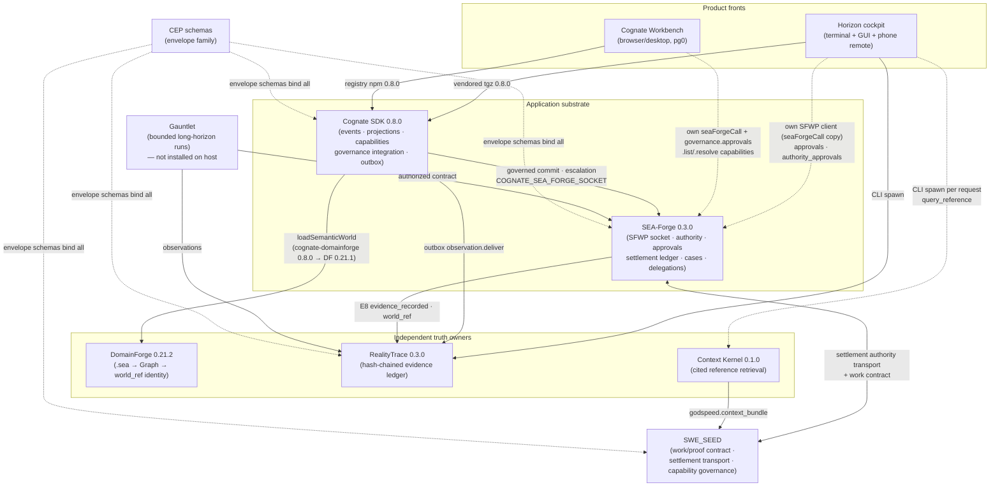
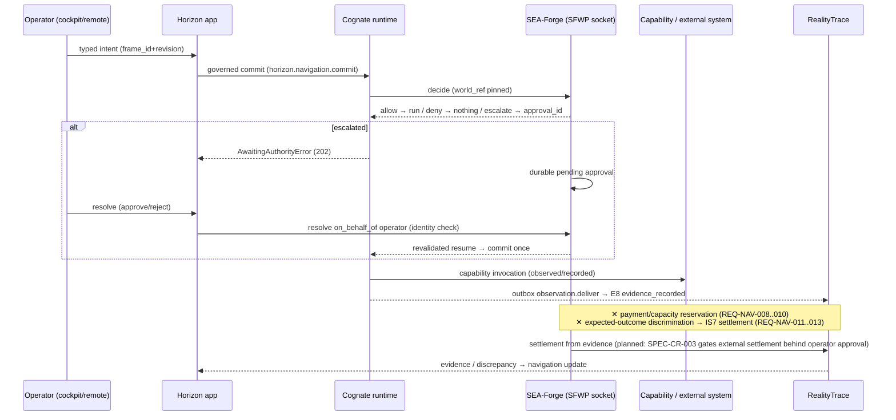

# 01 · Actual System Map — GodSpeed AI as implemented on 2026-11-04

Evidence conventions: **[F]** observed fact (file/commit cited) · **[I]** inference · **[P]** proposal · **[U]** unknown.
Reconnaissance was read-only. No repo was modified. Per-repo dossiers with full evidence trails are in `07-appendix-repo-dossiers.md`.

## 1. Component inventory (what actually exists)

| Product | Repo @ HEAD (2026-11-04) | Version / release state | What it actually implements |
| --- | --- | --- | --- |
| **DomainForge** | `domainforge` @ f90905a (main) | 0.21.2 on crates.io/npm/PyPI (2026-10-26) | `.sea` semantic language: pest grammar (582 lines, 29 declaration kinds), canonical `Graph` IR, 31 projection formats, `Graph.parseSourceMap` + `domainModelIdentityJson` + `worldRefFromIdentityJson` + `verifyWorldRef` identity chain. 1,294 Rust tests green (2026-10-30). |
| **Cognate SDK** | `cognate` @ 87333bc (security/repo-hygiene) | 0.8.0 npm, all 43 packages linked-version | Event-sourcing application runtime: `createRuntime` (runtime-bun), events/projections/continuations/capabilities, fail-closed governance env (`COGNATE_GOVERNANCE`/`SEA_FORGE_SOCKET`/`WORLD_REF`), governed-operation dispositions (allow/deny/escalate/unknown/constrained_allow/boundary/degraded), outbox→RealityTrace observation intents (`observation.deliver` topic). "Governance is integration, not enforcement" (README:307–320). |
| **Cognate Workbench** | `cognate-workbench` @ 96f7fb0 (feat/desktop-terminal-browser) | 0.1.0 desktop packages built (deb/exe/dmg in untracked `dist-package/`) | The *other* product front: browser app + docked PTY terminal + shared managed browser + dev-server previews + Tauri 2 desktop shell, pg0 (PostgreSQL) persistence, experts/teams/assignments, approval gates, steering. T12 mission journey green; 1,571 tests at `ec7fc4d` (2 load flakes). Status rev 39 (2026-11-04). |
| **SEA-Forge** | `sea-rs` @ b072ec50 (docs/egm-bootstrap-readmes); origin/main 22bf66a3 is 8 ahead | 0.3.0 installed on host; 0.4.0 release-please PR open | Governed capability-execution kernel: SFWP v1 NDJSON Unix-socket protocol (schema-typed, idempotency-keyed), authority engine (default-deny, allow/deny/escalate, OPA 1.21.1 candidate pinned), approvals + delegations, hash-chained settlement declaration ledger with pluggable `SettlementAuthority` (Local or SWE-seed), append-only audit ledger, agent delegation (OpenAI/Anthropic/ACP), MCP server. 25 crates + `apps/` (casework-go, cognitive-ui) + own `workbench/`. |
| **Gauntlet** | `gauntlet` @ 5842777 (release/native-distribution) | Run 8 packaging green; artifacts are CI artifacts only — no tag, not installed on host | Bounded long-horizon execution harness: frozen content-addressed Reference (`.gauntlet/reference.lock`), observe→compare→verify→correct→settle loop, budgeted runs (8 rounds/3600s/2M tokens/$25), PostgreSQL **required**, Rust CLI + OpenTUI operator TUI. |
| **RealityTrace (SXR)** | `sxr` @ c239d5c (feat/native-binary-distribution); origin/main 2 ahead (PR #12 merged) | 0.3.0 installed (`~/.cargo/bin` + root-owned gateway copy) | Append-only cryptographic evidence runtime: CEP-0008 envelope validation, 26 record kinds, SHA-256 hash chain, threshold evaluator, SQLite ledger + CAS store + FTS5, three-branch comparison (match/discrepancy/unresolved), E8 `evidence.recorded` with `source_agent: sea-forge`, `world_ref` syntax+equality checks, RT-1 verifier timing. Daemon is Unix-only. |
| **SWE_SEED** | `SWE_SEED` @ dac8eb7 (feat/native-distribution) | Native-candidate workflow added 2026-10-31; no green packaging run recorded yet | Software-work verification harness + capability-governance layer: routing/context-plan/trace lifecycle/gate `--verify` with Ed25519-signed ledger anchors, tamper-detection smoke; defines the work/proof contract between Context Kernel and SEA-Forge; external settlement-authority transport for SEA-Forge. |
| **Context Kernel** | `Context_Kernel` @ 36bd8c8 (main) | 0.1.0 | Evidence-bearing context assembly: 21 Rust crates, SQLite+FTS5, MCP tools (`query_reference`, `recall_context`, `context_required` → CEP `godspeed.context_bundle`, …). No RuVector/zvec here (that lives in `godspeed_agent`). github/web adapters implemented but not composed into the binary. |
| **CEP** | `cep` @ d7591c1 (profiles/context-bundle; content-equivalent to main squash) | Spec home, no runtime | Canonical Evaluation Protocol: 8 godspeed envelope schemas (semantic_snapshot, context_bundle, authority_request/decision, execution_trace, evidence_packet, settlement_packet, world-transition), validators in Python/Rust/TS. **Open debt: `content_hash`/`semantic_hash` have no defined algorithm/canonicalization.** |
| **godspeed_agent** | `godspeed_agent` @ 4bfed12 (migration/cep-world-required-evidence, unmerged since 2026-10-05) | — | Horizon's predecessor: navigation/developmental controller, 1,131 tests, evidence-mined developmental policies, Python ML research pipeline (settlement datasets, calibration, ROC-AUC tracked), `ruvector_bridge.py`, E1→E8 end-to-end world-loop test driven by sea-rs `scripts/e2e-world-loop.sh`. |
| **Horizon** | `Horizon` @ 18f0c40 (horizon-cockpit-projection-review; **48 commits ahead of origin/main**) | Spec HORIZON-001 **1.2.0** frozen 2026-11-02; gateway deployed on host (loopback 4319, systemd) | The product front this ecosystem is being sculpted around — see §3. |
| *(Supporting)* | `godspeed-readiness` @ ae90607 | GO 30/30 at 2026-10-25 heads | Cross-stack gate harness (31 YAML scenarios). Evidence now stale: **all 9 product heads have moved since the GO**; cognate is off-history after its forced history rewrite. |
| *(Supporting)* | `project-topology-architect`, `elephant-goldfish-model` | — | Method owners (skills: egm-bootstrap/brainstorm/draft/review/review-loop/resolve/drift-report). |
| *(Donor)* | `product-actualizer` @ c9df8d2 | Apache-2.0 (relicensed 2026-10-19) | Cockpit vocabulary + structure donor to Horizon; "vocabulary and structure only; no imported code" (`Horizon/docs/donors.md:8–22`). |

## 2. Cross-repo runtime topology (as wired today)

Dotted lines are integrations that bypass Cognate (relevant to Horizon invariant INV-2, `2026-11-02-production-readiness-plan.md` P3.1).

**The live governed-commit runtime path** (the estate's verified core, proven by `test/J02-live.test.ts` on a real `sea-forge-server`; payment/IS7 legs marked ✕ are REQ-NAV-008..013, not yet implemented):

**The one place the whole stack chains through a pinned `world_ref` end-to-end** is godspeed_agent's E1→E8 loop test (`godspeed_agent/tests/test_e2e_world_loop.py:1-95`), driven externally by sea-rs. [F]

## 3. Horizon itself — implemented state

- **Task ledger:** T00–T10 settled (topology, IDM, behavioral IR J01–J06, atomic UI IR, walking skeleton + justfile, closed surface grammar, operational projections, navigation frames, sequential terminal, React GUI projection, world debugger). **T11 (independent SEA-Forge authority, P3 proof) is the recorded next-ready task**; `gate-t11..t22` are fail-closed stubs (`justfile:201–240`). [F]
- **Spec:** HORIZON-001 v1.2.0 (frozen 2026-11-02; adds REQ-SEC-006 WebAuthn operator identity; sha `7b06f6b8…`). 105 requirements. REQ-NAV-008..013 (payment/capacity/expected-outcome/IS7 settlement) are **specified but not implemented**; they ship together with gate J02 revision 2 (`test/J02r2-live.test.ts` exists; no recorded pass). [F]
- **Live vs fixture:** J02-live (operate journey: allow/deny/offline/escalate/self-approval-refusal/operator-approval/rejection) runs against a real `sea-forge-server`. J01/J03–J06 remain fixture-proven (`behavioral/journeys/*.yaml`). [F]
- **Cockpit (current branch, 48 commits):** ordered settlement stages, approval inbox (`GET /workspace/approvals` + typed references), one-primary-action workspace, gateway two-account hardening (protected socket group, operator ≠ service account), phone remote with WebAuthn + QR pairing, vendored Cognate 0.8.0. Full suite 466 pass / 0 fail recorded at `ad1b139`. [F]
- **Deployed on this host:** Horizon gateway as `godspeed-horizon.service` (loopback 4319), staged runtime under `/opt` with digest, root-owned `bun` + `realitytrace` under `/usr/local/lib/godspeed-horizon/bin/`, SEA-Forge gateway instance with protected socket dir `/run/godspeed-sea-forge` (`2026-11-02-production-readiness-plan.md` §2, `docs/gateway-runbook.md`). [F]
- **In flight (beyond the status ledger):** SPEC-CR-003 settlement-approval-gate candidate (worktree `Horizon-settlement-gate` @ 8894d6d, revised 2026-11-03); its implementation (worktree `horizon-settlement-gate` @ a2d98ff, gateway policy renders `requires_approval` for external-authority settlement); and the not-yet-run live roundtrip runbook (`.agents/reports/2026-11-03-settlement-live-roundtrip-runbook.md`, targets sea-rs ≥ 09c2541b). [F]
- **Presentation-side contract:** the **Horizon Master UI Specification v1.0** (2026-11-04, design-only, grants no implementation permission) exists at `.tmp/Horizon_Master_UI_Spec_v1_0.md` — three donor-grounded compositions (Explore/Operate/Work) + stable shell over the six experiences, component-to-source traceability table, phases 0–6, a verification matrix, and an A–E work-scope gate. It is unversioned (gitignored `.tmp/`) and cites CognitiveOS Manifesto v13.1 while the workspace canonical is v17 — see T-EGM-3/T-EGM-4. Theory sources: `godspeed-growth/world/cognitive_os_manifesto_v17.md` (unfrozen canonical) + `cognitiveos_math_layer_v2_3.md`. [F]

## 4. Installed-runtime reality on this host [F]

| Binary | Location | Notes |
| --- | --- | --- |
| `sea-forge`, `sea-forge-server`, `sea-forge-mcp-connect`, `sea-forge-workload-exec` | `~/.local/bin` (2026-11-01) | 0.3.0. **No sea-forge process running**; `~/.sea-forge/server.sock` stale (Aug 31). The *gateway* instance is separate (protected path). |
| `realitytrace` | `~/.cargo/bin` + `/usr/local/lib/godspeed-horizon/bin/` (2026-11-02) | 0.3.0, built from sxr c239d5c. |
| `horizon` | `~/.local/bin` wrapper + `/opt` staged runtime | systemd service, loopback 4319. |
| `gauntlet` | **not installed** | Only `gauntlet/target/release/gauntlet` build output. Distribution settled but untagged; PostgreSQL required. |
| `swe-seed` | **not installed** | Native candidate workflow not yet run green. |

## 5. EGM bootstrap state across the estate [F]

| Repo | Bootstrap | Drift since generation |
| --- | --- | --- |
| DomainForge | 61 EGM.md (2026-10-30, `0a5d71c`) | One source commit since; minor manual touch-up warranted (`domainforge-core/src/cli/EGM.md:19` stale "stub" claim). No regen needed. |
| Cognate | ~166 EGM.md (2026-10-30, `cb8d763`) | Root EGM cites status rev 74; ledger at 78. Hygiene commits postdate generation. No mechanical gate ranges over the EGM tree (status rev 75 admits this). |
| sea-rs | 150 README-contract format (2026-10-30, `aecfdf22`); drift report run, 10/14 fixed | 3 items left for human triage (incl. crates/AGENTS.md saying 22 crates vs 25 actual). Branch not yet PR'd. |
| Horizon | EGM.md at root + per-dir | Current branch (48 commits) postdates generation; cockpit work not reflected. |
| Gauntlet, SXR, SWE_SEED, Context_Kernel, CEP, godspeed_agent, Workbench | **No EGM bootstrap** | Bootstrap candidates, priority = Workbench and sea-rs apps (they hold product surfaces). |

No full re-bootstrap is warranted anywhere; targeted refreshes only (see `02`, finding T-EGM-1).

## 6. What is genuinely strong (observed)

1. **The authority/evidence spine works and is tested live:** Horizon → Cognate governed commit → SEA-Forge escalate → durable approval → operator resolve → single commit; rejection commits nothing; self-approval refused when identity is unknown (commit 18f0c40; `test/J02-live.test.ts`). [F]
2. **world_ref immutability is enforced at every boundary that matters:** DomainForge identity chain, Cognate fail-closed env validation, SEA-Forge digest recomputation, SXR equality checks, godspeed_agent drift refusal. [F]
3. **Determinism discipline:** Cognate 0.6.3 made traces pure functions of committed events so hash checks hold at any later time; SXR aarch64 tarball byte-identical across Gauntlet packaging runs 7/8. [F]
4. **Fail-closed culture is real, not rhetorical:** Horizon boundary teeth with mutation runners; SWE_SEED tamper-detection smoke; SXR missing-ledger-fails-closed; Cognate partial governance env throws. [F]
5. **Independent-observer review discipline exists:** Horizon SPEC-CR rounds (r1 REJECT → r6 ACCEPT), brief v3's six EGM lenses, sea-rs CodeRabbit Major findings driving fixes. [F]
