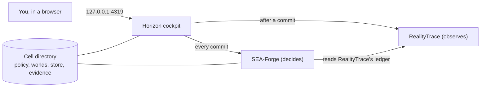

# IGNITION: from a bare machine to the governed Horizon cockpit

This runbook takes a new or reused Linux machine to a running Horizon cockpit, governed by SEA-Forge and observed by RealityTrace. It ends with you in the cockpit, ready to open a case and commit your first governed move. Each step ends with a **check**. Don't continue until the check passes.

Time: about 20 minutes, most of it spent compiling RealityTrace.



What to notice: Horizon never decides anything. SEA-Forge rules on every commit, RealityTrace records what happened, and all three keep their state in one cell directory on your machine.

## What you need

| Requirement | Why |
|---|---|
| Linux x86_64 with glibc 2.39 or newer (Ubuntu 24.04+, or WSL2 running Ubuntu 24.04+) | The SEA-Forge release binary is built for x86_64 glibc only. |
| 4 GB RAM, 3 GB free disk | Compiling RealityTrace, plus the running stack (about 450 MB). |
| A GitHub account with read access to `GodSpeedAI/Horizon` | Horizon is a private repository. SEA-Forge and RealityTrace are public. |
| Network access to github.com, crates.io and the npm registry | Downloads only; the running stack is local and binds to loopback. |

Check your platform:

```bash
uname -m && ldd --version | head -1
```

**Check:** prints `x86_64` and a glibc version of 2.39 or higher.

## Step 1. System packages

```bash
sudo apt-get update
sudo apt-get install -y git curl unzip ca-certificates build-essential pkg-config libsqlite3-dev gh
```

`build-essential`, `pkg-config` and `libsqlite3-dev` are needed to compile RealityTrace, which links the system SQLite.

**Check:** `gh --version && pkg-config --modversion sqlite3` prints both versions.

## Step 2. Toolchains

Install Rust, Bun, uv and just. Skip any that you already have at these versions or newer.

```bash
curl --proto '=https' --tlsv1.2 -sSf https://sh.rustup.rs | sh -s -- -y   # Rust 1.92 or newer
curl -fsSL https://bun.sh/install | bash -s "bun-v1.4.0"                  # Bun 1.4.0 or newer
curl -LsSf https://astral.sh/uv/install.sh | sh                           # uv (provides Python 3.12+)
. "$HOME/.cargo/env"
cargo install just --locked
exec "$SHELL" -l                                                          # pick up the new PATH entries
```

**Check:**

```bash
rustc --version && bun --version && uv --version && just --version
```

Expect Rust 1.92 or newer, Bun 1.4.0 or newer, and any recent uv and just.

## Step 3. Sign in to GitHub

```bash
gh auth login
```

Choose GitHub.com and HTTPS, then follow the prompts.

**Check:** `gh repo view GodSpeedAI/Horizon --json name` prints `{"name":"Horizon"}`. If it says the repository is not found, your account has no access to Horizon yet. Ask a maintainer for read access.

## Step 4. Install SEA-Forge (the authority)

Download the release and its checksums into an empty directory, verify them, and install both binaries:

```bash
mkdir -p ~/.local/bin /tmp/sea-forge-release && cd /tmp/sea-forge-release
gh release download v0.2.0 --repo GodSpeedAI/SEA-Forge \
  -p 'sea-forge-*-x86_64-unknown-linux-gnu.tar.gz' -p SHA256SUMS
sha256sum -c SHA256SUMS
tar -xzf sea-forge-0.2.0-x86_64-unknown-linux-gnu.tar.gz
install -m 755 sea-forge-0.2.0-x86_64-unknown-linux-gnu/sea-forge* ~/.local/bin/
cd ~
```

Releases after v0.2.0 also carry a signed build provenance attestation. For those releases, verify it with `gh attestation verify <tarball> --repo GodSpeedAI/SEA-Forge` as well.

**Check:**

```bash
sha256sum -c /tmp/sea-forge-release/SHA256SUMS   # ...tar.gz: OK
sea-forge --version                              # sea-forge 0.2.0
command -v sea-forge-server                      # ~/.local/bin/sea-forge-server
```

If `command -v` prints nothing, add `~/.local/bin` to your PATH (`export PATH="$HOME/.local/bin:$PATH"` in `~/.bashrc`) and open a new shell.

## Step 5. Install RealityTrace (the observer)

```bash
cargo install realitytrace --version 0.3.0 --locked
```

This compiles for several minutes.

**Check:** `realitytrace --version` prints `realitytrace 0.3.0`.

## Step 6. Get Horizon and its dependencies

```bash
mkdir -p ~/projects && gh repo clone GodSpeedAI/Horizon ~/projects/Horizon
cd ~/projects/Horizon
just setup
bun run check
```

`just setup` installs the JavaScript dependencies (Horizon's own Cognate packages are vendored in the repository) and the Python research environment.

**Check:** the last line is `check: ok (local_operator, 127.0.0.1:4319, horizon)`.

## Step 7. Ignite

```bash
cd ~/projects/Horizon
bun run ignite
```

`bun run ignite` does three things:

1. It creates a cell directory at `~/.local/share/horizon/cell` and copies in Horizon's world, a SEA-Forge configuration and a policy.
2. It starts SEA-Forge on that cell.
3. It starts the cockpit with governance, approvals and RealityTrace switched on.

Leave it running in this terminal.

**Check:** within a few seconds the terminal prints:

```text
ignite: cell /home/<you>/.local/share/horizon/cell
ignite: SEA-Forge /home/<you>/.local/bin/sea-forge-server (log .../cell/sea-forge.log)
ignite: RealityTrace /home/<you>/.cargo/bin/realitytrace
horizon: local_operator listening on http://127.0.0.1:4319/
horizon: workspace http://127.0.0.1:4319/workspace
```

If it prints `ignite: ...` followed by `fix: ...`, a prerequisite is missing. Do what the `fix:` line says, then run `bun run ignite` again.

Options:

- `bun run ignite --approve-commits`: on the first run, writes a policy where every commit waits for your approval. Use it to see escalation end to end.
- `bun run ignite --cell DIR`: uses a different cell, for example a throwaway one for experiments.

## Step 8. Your first governed move

Open **http://127.0.0.1:4319/** in a browser on the same machine. On WSL2, the Windows browser reaches it at the same address.

**Check:** the status rail under the title reads `SEA-Forge: governing`, `RealityTrace: observing` and `Approvals: you can approve`. If any of them says `off`, the cockpit wasn't started by `bun run ignite`. Stop it and start it again with Step 7.

The **Getting started** panel takes you through three steps:

1. **Connect the stack.** This step is already checked. It's only checked when SEA-Forge and RealityTrace are both connected.
2. **Open a case.** Type what you're trying to move forward, for example `Prove the governed loop on this machine`, and choose **Open case**. The case is stored and frames the workspace from now on.
3. **Commit your first governed move.** Choose **Check the structural world and Cognate projection**.

The cockpit then shows a **Decision receipt** with three separate claims:

| Row | What it tells you |
|---|---|
| Decided | What SEA-Forge ruled: allowed, refused (with its reason), or awaiting your approval. |
| Recorded | Whether Horizon wrote the intent record, and when. |
| Observed | Whether RealityTrace has observed the commit. |

If you started with `--approve-commits`, Decided says **Awaiting your approval at SEA-Forge**. Choose **Approve**. SEA-Forge checks the move again and commits it once.

Then choose **Observe and settle**. RealityTrace observes the committed trace and SEA-Forge rules on that evidence.

**Check:**

- Decided reads `Allowed by SEA-Forge.`
- Recorded reads `Recorded by Horizon, <time>.`
- Observed reads `Observed by RealityTrace: <id>.`
- Settlement reads `Unsettled: SEA-Forge recorded the evidence, and it does not prove an expected outcome.`

"Unsettled" is correct here. The health check names no expected outcome, so there is nothing for the evidence to prove.

You're now activated: the Getting started panel goes away, and **Your governed moves** lists the commit with its three claims.

## Day to day

- **Start your day.** Run `cd ~/projects/Horizon && bun run ignite` and open http://127.0.0.1:4319/. The cell keeps your case, your moves and their evidence across restarts.
- **Open a case.** When you start new work, open a case with its purpose. The workspace frames itself on the latest case.
- **Change what needs approval.** Edit `~/.local/share/horizon/cell/policy.yaml`. SEA-Forge rereads the policy on every decision, so edits apply without a restart. Add `requires_approval: true` to a rule to make its commits wait for you, or set `verdict: deny` to refuse them.
- **Use the terminal instead.** `bun run src/main.ts frame --text` prints the same frame, and `bun run src/main.ts act --operation horizon.health` commits through the same pipeline. To keep them governed, run them with the environment `bun run ignite` sets (see `scripts/ignite.ts`).
- **Stop.** Press Ctrl+C in the ignite terminal. That stops the cockpit and SEA-Forge together.
- **Control from your phone.** Run `bun run ignite --remote` (or `--remote https://your-host` for a tunnel you run), then start remote control from the cockpit's panel and scan the QR. Nothing starts until you press Start. See [REMOTE](REMOTE.md).

## Where things live

| Path (in the cell) | Contents |
|---|---|
| `policy.yaml` | Your SEA-Forge policy. Written once, then yours. |
| `server.yaml` | SEA-Forge configuration, regenerated on each ignite. |
| `worlds/` | The copy of Horizon's world that SEA-Forge governs, refreshed on each ignite. |
| `app.sqlite` | Horizon's store: cases, intents, attempts, settlements. |
| `realitytrace/` | RealityTrace's data and state homes. |
| `ledgers/`, `sea-forge.log` | SEA-Forge's ledgers and log. |
| `local-operator.secret` | A per-launch secret (mode 0600). Never share it. |

To start over, stop ignite and delete the cell: `rm -rf ~/.local/share/horizon/cell`. This deletes every case, decision and observation in it.

## Troubleshooting

| Symptom | Cause | Fix |
|---|---|---|
| `ignite: sea-forge-server not found` | SEA-Forge isn't on PATH. | Repeat Step 4, or set `SEA_FORGE_SERVER_BIN=/path/to/sea-forge-server`. |
| `ignite: realitytrace not found` | RealityTrace isn't installed. | Repeat Step 5, or set `REALITYTRACE_BIN`. |
| `ignite: dependencies are not installed` | `just setup` was not run. | Run `just setup` in the Horizon checkout. |
| `ignite: sea-forge-server exited with code 1` | SEA-Forge refused its configuration. | Read the log path ignite printed; SEA-Forge's message names the fix. |
| `sea-forge-server: ... GLIBC_2.39 not found` | The OS is older than Ubuntu 24.04. | Use Ubuntu 24.04+ (or WSL2 with it), or build SEA-Forge from source with Rust 1.99. |
| `cargo install realitytrace` fails at `libsqlite3-sys` | SQLite headers are missing. | `sudo apt-get install -y pkg-config libsqlite3-dev`, then retry. |
| `a SEA-Forge server is already listening` | Another ignite is running on this cell. | Stop it, or use `--cell` with another directory. |
| The browser can't reach 127.0.0.1:4319 | The cockpit isn't running, or the port is taken. | Check the ignite terminal; `ss -ltnp | grep 4319` shows what holds the port. |
| A POST returns `403` | The request came from another site or host name. | Use http://127.0.0.1:4319 or http://localhost:4319 directly. The cockpit refuses cross-site requests by design. |
| Decided says `Refused by SEA-Forge` | Your policy denies the move. | Expected when a rule says `verdict: deny`; edit `policy.yaml` if that's not what you want. |

## Optional: the rest of the GodSpeed stack

Horizon doesn't need the other GodSpeed products to run. Cognate Workbench, Context Kernel and SWE_SEED each have their own README. They aren't required for anything in this runbook.
