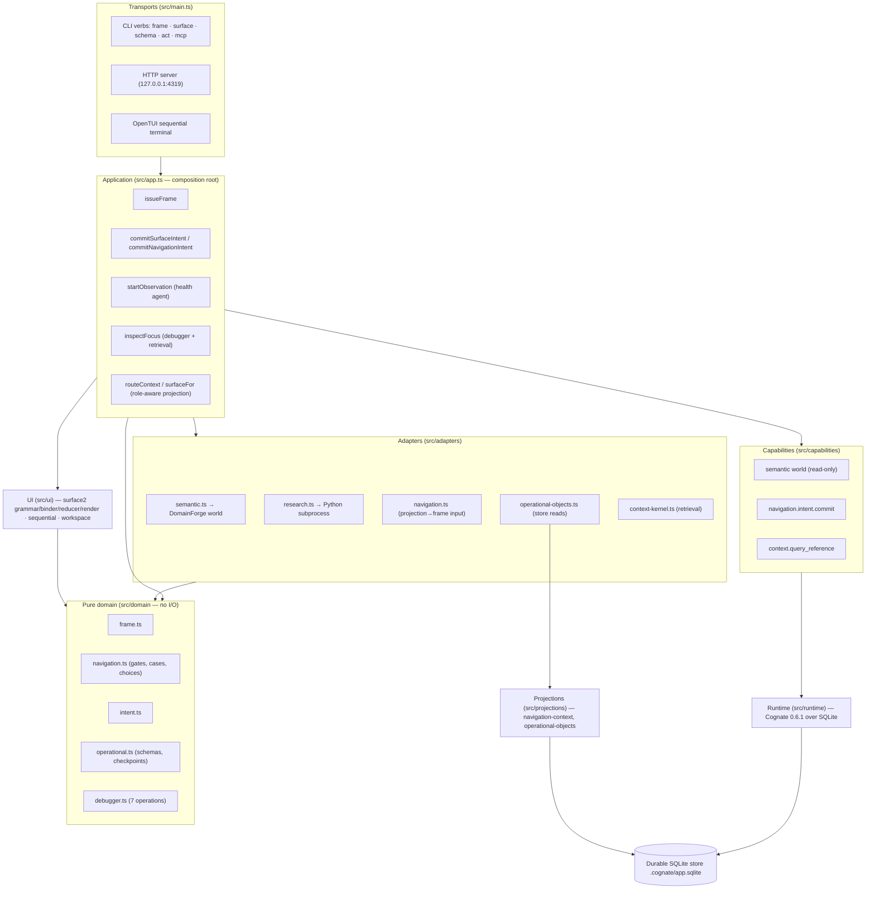
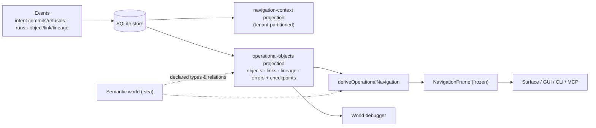
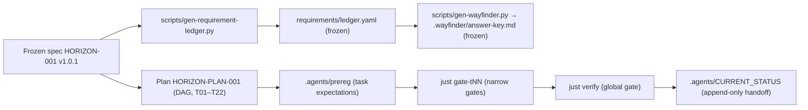

# Horizon architecture

Canonical high-level architecture of the *implemented* system (walking skeleton through
task T10). For product intent see [`README.md`](../README.md); for normative rules see
[`AGENTS.md`](../AGENTS.md).

---

## 1. Logical architecture

Horizon is a layered application with a deliberately thin center:

What to notice:

- **The domain layer is pure.** `src/domain/` imports nothing from adapters, runtime, or UI
  (enforced by `scripts/check-boundaries.ts`). All behavior that must be stable — frames,
  gates, cases, intent validation, debugger answers — is defined and tested there without
  I/O.
- **Adapters are the only I/O edges.** World loading, research health, retrieval, and store
  access each live behind one adapter with typed failures.
- **The UI layer is projection only.** `src/ui/` derives renderings from frames and
  surfaces; the boundary rules forbid `src/ui` from importing any adapter or runtime
  module (`scripts/check-boundaries.ts` L129), and a dedicated T10 tooth additionally
  guards against a direct Context Kernel import in surface code.

Non-goals (deliberate non-responsibilities): Horizon is not a DomainForge compiler, not a
Cognate state runtime, not a policy authority (SEA-Forge), not an execution harness
(Gauntlet), and not an evidence database (RealityTrace). Those are typed seams.

## 2. Runtime architecture

One process, one durable store:

- `bun run src/main.ts` boots `createApplication()` (`src/app.ts:144`), which:
  1. loads and validates `config/horizon.toml` and writes a per-launch secret to
     `.cognate/local-operator.secret` (`src/config/load.ts`);
  2. loads the pinned semantic world via `@godspeedai/cognate-domainforge`
     (`src/adapters/semantic.ts`) — a `world_ref` mismatch fails startup;
  3. probes the Python research subsystem (`research_command` from config) with a timeout;
     absence yields the typed degraded state `research_unavailable`, never a crash
     (`src/adapters/research.ts`);
  4. composes the Cognate runtime over the durable SQLite store with a read-only capability
     policy and an explicit allowed-action list (`src/runtime/create.ts`);
  5. starts a Bun HTTP server on `127.0.0.1:4319` and prints the world, Cognate-world, and
     semantic counts (`src/main.ts`).
- The single SQLite store holds the event log (intent records, intent attempts, run events,
  object/link/lineage events) plus tenant-partitioned projection rows and checkpoints.
  Projections are rebuildable from events.
- Cognate is vendored as 0.6.1 tarballs under `.cognate/vendor/` (see
  [donors](donors.md)); `src/runtime/required-cognate.ts` pins the required version.

## 3. Dependency architecture

Direction rules (verified by `just boundaries` → `scripts/check-boundaries.ts`):

| Rule | Why |
| --- | --- |
| `domain` → nothing | Behavior must be testable and stable without I/O |
| `ui` → `domain` only (plus vendored terminal kit) | Rendering must not gain authority or side channels |
| `adapters` → `domain`; never the reverse | The domain defines contracts; adapters implement them |
| `capabilities` → `adapters` + `domain` + runtime | Capabilities are the only path to mutation-capable actions |
| everything → `config` types | Configuration is leaf-shaped and validated once |
| `src/ui` ✗ `adapters/context-kernel` | Retrieval must not leak into rendering (T10 tooth PE-14) |

External dependencies: Cognate 0.6.1 (vendored), OpenTUI + React (terminal and GUI
rendering), DomainForge CLI 0.22.0 (gate-time only, pinned via `DOMAINFORGE_BIN`), Python
≥ 3.12 with uv (research subsystem and behavioral proof engine).

## 4. Data architecture

State ownership:

| State | Owner | Lifetime | Notes |
| --- | --- | --- | --- |
| Event log | Cognate runtime store | durable, append-only | streams for intents/attempts/runs/objects |
| Projection rows + checkpoints | `src/projections/*` | derived, rebuildable | tenant-prefixed keys |
| Navigation frames | application `FrameRegister` + store | per decision, immutable once issued | stale frames refused |
| Config + launch secret | `src/config` | per launch | secret at `.cognate/local-operator.secret`, not committed |
| Semantic world | `src/adapters/semantic` | immutable for process lifetime | identity asserted against pinned hash |

Consistency: the store is single-writer (SQLite); projections read from stream positions
(checkpoints) so every read is reproducible; the debugger refuses unbounded traversal and
requires bounds rather than defaults.

## 5. Control flow

- **Transports never mutate directly.** CLI verbs, GUI forms, and MCP tools resolve
  through `application.surface()`/`commitSurfaceIntent()` (`src/main.ts` header; enforced
  by `teeth-t05-equivalence`).
- **The application orchestrates.** `issueFrame → submitIntent/commitNavigationIntent →
  startObservation → projections` is the only mutation pipeline
  (`src/app.ts:173–260`).
- **Agents are started, never self-starting.** The health agent runs from a *committed*
  intent (`src/agents/health.ts`).
- **Authority gates live in the domain**, so every transport inherits the same verdicts
  (`assessAffordance`, `src/domain/navigation.ts`).

## 6. Trust and security boundaries

- **Trusted local boundary.** `deployment_profile = "local_operator"`, loopback bind,
  OS-session-derived principals (`os:` operator / `agent:` agents). This is a single-user
  trust model; Product Actualizer's loopback token model is explicitly *not* a remote or
  multi-user security model (`AGENTS.md` §10).
- **Closed surface.** Agents can compose surfaces but cannot send HTML/CSS/JS/DOM; the
  grammar refuses executable markup and escaping is enforced at render time
  (`src/ui/surface2/grammar.ts`, `render.ts`; tested in `test/surface-negative.test.ts`).
- **Attribution is structural.** Agent-composed material is downgraded by the reducer;
  an agent cannot claim human authorship or approve its own consequential action.
- **Retrieval grants nothing.** CK citations are classed `untrusted_reference` by Horizon
  itself (`src/capabilities/context.ts`), so a retrieved instruction can never become an
  action.
- **Fail closed.** Unknown/denied authority, stale frames, missing bounds, invalid worlds,
  and absent settlement evidence all refuse with typed errors.
- **Secrets.** One per-launch secret written locally; never committed (`.gitignore`).

## 7. Governance architecture (the fifth layer)

Horizon's most unusual subsystem is its governance machinery, which is load-bearing:

Every `gate-tNN` composes narrow checks, coverage, teeth, and the global gate set
(`check boundaries idm-integrity acceptance-claims witness-claims contract-modals test
ledger wayfinder teeth`). See [workflows](workflows.md#5-verification-gates) and the
[reference](reference.md#just-targets-full-list-justfile).

## 8. Implementation status (what is real vs seam)

| Real (implemented + gated) | Typed seam (not yet live) |
| --- | --- |
| Semantic world load, pinned identity | Live SEA-Forge authorization (T11+) |
| Frames, intents, attempts, audit | Gauntlet pinned execution |
| Event-sourced operational projection | RealityTrace evidence delivery |
| Closed surface + 3 transports + equivalence | Live Context Kernel process (wire scripted in tests) |
| 7-operation debugger, labelled values | Product integrations (DomainForge proposals, Gauntlet runs) |
| CK capability + policy + scope refusals | ML research behavior (Python side is contract-only, `ml: false`) |
| Behavioral proofs J01–J06 with teeth | Independent P3 confirmation for recent tasks |

Per `.agents/CURRENT_STATUS.md` (rev 24): T10 settled at P2; T11 next; `just verify` exit 0;
139 bun tests + 4 research tests passing; spec hash unchanged.

### Source trail

- `src/app.ts` — `createApplication`, `issueFrame`, `submitIntent`, `commitSurfaceIntent`,
  `inspectFocus`, HTTP server wiring
- `src/main.ts` — transport verbs and renderer mounting
- `src/domain/navigation.ts` — gates, affordance assessment, frame building
- `src/domain/debugger.ts` — debugger operations and value classes
- `src/runtime/create.ts` — Cognate runtime composition, store boundary assertion
- `scripts/check-boundaries.ts` — dependency-direction enforcement
- `scripts/check.ts` — type/config/structural integrity
- `.agents/CURRENT_STATUS.md` — current implemented stage
- `docs/donors.md` — donor provenance and license attribution
