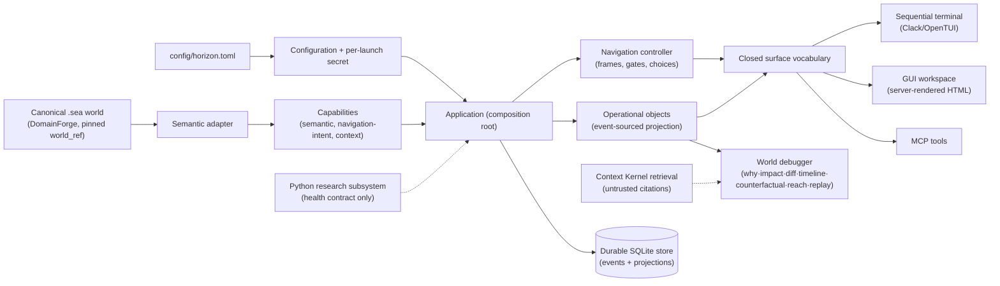
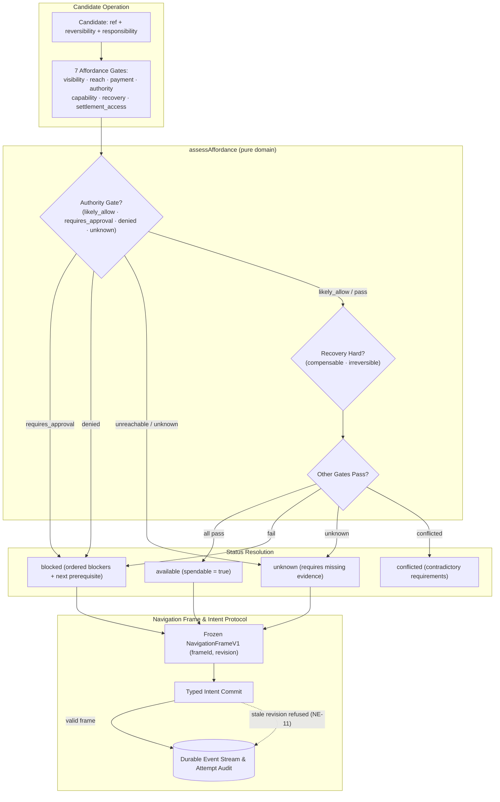

# Horizon documentation

Horizon is GodSpeed AI's **observer-relative navigation environment**: an application that
loads one immutable semantic world (compiled by [DomainForge](https://github.com/GodSpeedAI)
into a `.sea` interaction model) and lets a human observer — or an agent acting for one —
navigate that world through typed, authority-gated decisions. The same interaction contract
is rendered identically by three transports: a sequential terminal (Clack-style, OpenTUI),
a server-rendered graphical workspace, and MCP tools.

**Read this first:** [`README.md`](../README.md) describes the *intended* product and uses
future tense ("Horizon will…"). It is a vision document, not a feature list. What is
actually implemented today is the walking skeleton that reached task T10: the navigation
frame, intent commit pipeline, closed surface vocabulary, three renderers, the seven-operation
world debugger, Context Kernel retrieval as untrusted citations, and a large verification
battery. Tasks T11 onward (live SEA-Forge authorization, Gauntlet execution, RealityTrace
evidence, product integrations) are still typed seams, not working code.

## The system in one picture

What to notice: every renderer consumes the same navigation frame and the same surface
projection; nothing mutates the world except the typed intent pipeline; retrieval is a side
channel that is never allowed to become an action.

## The 10 concepts you need first

Defined precisely in the [glossary](glossary.md); the short forms:

1. **World / `world_ref`** — the immutable semantic model; its identity is a DomainForge
   content hash, pinned in config and asserted at boot.
2. **Navigation frame** — a versioned, frozen snapshot of "the decision in front of the
   observer right now": focus, checkpoint, choices, gate verdicts.
3. **Intent** — a typed, role-bound choice validated against the frame that issued it.
4. **Affordance gates** — `visibility`, `reach`, `payment`, `authority`, `capability`,
   `recovery`, `settlement_access` (`GATE_KEYS`). An operation can exist yet be *blocked*;
   possibility is not affordance.
5. **Case** — a purpose-relative *derived* view over facts; never an identity or authority.
6. **Operational object** — a runtime row (with provenance) projected from events.
7. **Checkpoint** — a named read position in a projection stream; cross-checkpoint reads
   must say which checkpoint they used.
8. **Surface** — a closed, validated declarative vocabulary (15 block types). Agents may
   compose it; they may not send HTML/JS/DOM.
9. **Untrusted reference** — a Context Kernel citation; Horizon classifies it itself, and it
   can never authorize anything.
10. **Teeth** — adversarial verification: a test that must *fail* when a protected property
    is broken, kept separate from coverage tests so neither can impersonate the other.

## A representative journey

An observer asks "why does this object look wrong?" (`J01` explore, then the debugger):

1. The application loads the pinned `.sea` world at boot and serves read-only capabilities.
2. `horizon frame` (or the GUI home view) builds a **navigation frame** from the operational
   projection: current focus, checkpoint, case (if any), and the assessed choices.
3. The sequential renderer asks one question at a time; the GUI composes regions; both emit
   the **same typed intents**.
4. A committed intent is validated against its frame, appended to the durable event log, and
   triggers a deterministic observation run; projections update.
5. Inspection runs a **debugger operation** (`why`, `impact`, …) over the projection; every
   value is labelled `recorded`, `derived`, `unknown`, `effect`, or `untrusted_reference`.
6. Anything that would *change* the world must pass authority gates — and today, without
   live SEA-Forge, consequential authority fails closed.

## Where to go next

| I want to… | Read |
| --- | --- |
| Explore system behavior interactively | [Interactive explainers](explainers/index.md) (affordance simulator & debugger workbench) |
| Install the whole stack on a new machine and reach the cockpit | [IGNITION](IGNITION.md) |
| Run Horizon, see what it does | [how-to: run and inspect](how-to.md#run-the-application) |
| Understand the architecture | [architecture](architecture.md) |
| Understand a subsystem in depth | [subsystems](documentation-map.md) |
| Follow what happens at runtime | [workflows](workflows.md) |
| Learn *why* it is built this way | [explanation](explanation.md) |
| Add a capability, block type, or renderer | [how-to: extend](how-to.md#extend-the-system) |
| Look up a command, key, or schema | [reference](reference.md) |
| Diagnose a failure | [troubleshooting](troubleshooting.md) |
| Understand the governance machinery (spec, ledger, teeth) | [explanation: frozen artifacts](explanation.md#frozen-artifacts-and-why-they-exist) |

## Canonical knowledge ownership

This documentation system points at single canonical homes rather than copying them:

- Normative rules and boundaries: [`AGENTS.md`](../AGENTS.md) (do not duplicate here).
- Canonical interaction semantics: `.sea/interaction/` (see
  [semantic world](subsystems/semantic-world.md)).
- Journey definitions J01–J06: `.sea/interaction/canonical-journey-catalog.md`.
- Current task state: `.agents/CURRENT_STATUS.md`.
- Donor provenance: [donors.md](donors.md).
- Requirement truth: `requirements/ledger.yaml` + `.wayfinder/answer-key.md` (frozen).

### Source trail

- `src/main.ts` — CLI verbs and server startup (all transports)
- `README.md` — aspirational product description (contrast with implemented state)
- `.agents/CURRENT_STATUS.md` — current implemented stage (T10 settled, T11 next)
