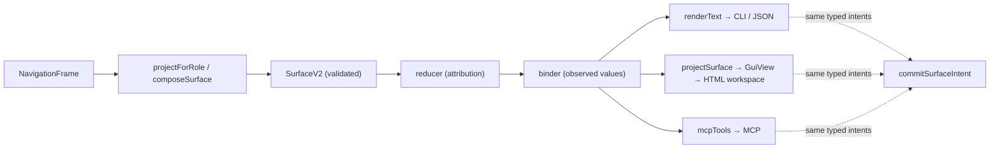
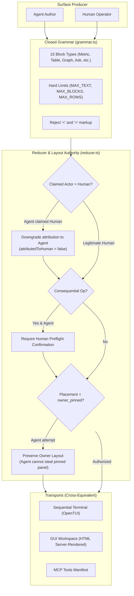

# Subsystem: surfaces and transports

One closed declarative surface vocabulary, rendered identically by three transports.

## Purpose

Let agents and the system *compose* rich presentations without ever gaining the power to
execute code, forge attribution, or diverge in meaning between terminal, GUI, and MCP.

## Responsibilities

The surface pipeline (`src/ui/surface2/`):

| Stage | File | Role |
| --- | --- | --- |
| Grammar | `grammar.ts` | closed schema: 15 block types, roles, intents, placements, provenance, actor attribution, hard limits (`MAX_BLOCKS`, `MAX_ROWS`, `MAX_NODES`, `MAX_TEXT`), ref patterns (`SEMANTIC_REF`, `WORLD_REF`, `EVIDENCE_REF`, `FRAME_REF`, `EXECUTION_REF`, `CASE_REF`), source expressions (`parseSourceExpression`); `parseSurface` refuses invalid compositions with issues, never partials |
| Projection | `project.ts` | surface → `GuiView` (nodes + actions) for HTML/MCP |
| Binding | `binder.ts` | typed source binding: `observed` / `blocked` / `refused` statuses; file-backed sources restricted to allowed roots via realpath, size-capped (`DEFAULT_MAX_FILE_BYTES`) |
| Reduction | `reducer.ts` | actor-attribution enforcement: agent material downgraded, agent-offered consequential ops require human preflight, presenter cannot steal pinned layout (`claimed`, `allowed`, `attributionChanged`) |
| Rendering | `render.ts` | `renderText` (with `escapeHtml` on the HTML path), `mcpTools` derived from `HORIZON_OPERATIONS` — never hand-listed |
| Equivalence | `equivalent.ts` | `intentsEquivalent` — the same operation offered/submitted across transports must resolve identically |

The application seam (`src/app.ts` `surfaceFor`/`routeContext`/`commitSurfaceIntent`, plus
`src/ui/surface.ts` role-aware projection and `frameFromCheckpoint`) connects frames to
surfaces for each transport.

## Non-responsibilities

- No authority decisions (domain owns gates).
- No direct mutation — even `act` goes through `commitSurfaceIntent`.
- No dynamic layout for agents: placements are grammar-authorized
  (`LAYOUT_AUTHORIZED`); the observer's pinned layout is not stealable.

## Position in the system

Consumed by `src/main.ts` (CLI verbs `surface`, `schema`, `mcp`), the HTTP routes
(workspace page + intent POST), and the sequential renderer's shared frame. Downstream of
[navigation](navigation.md).

## The three transports

- **Sequential terminal (T08)** — `src/ui/sequential/controller.ts` (646 lines): sessions,
  one prompt at a time (`promptFor`, `reviewFor`, `notice`), stale-frame detection
  (`isStale`), typed `SequentialIntent`s that are *recorded, never executed*; the vendored
  OpenTUI kit (`src/ui/sequential/vendor/terminal-ui/`) supplies Clack-style components,
  themes, and keyboard handling; `src/ui/sequential/terminal.tsx` mounts it.
- **GUI workspace (T09)** — `src/ui/workspace/model.ts` builds a fixed-region snapshot
  (`WORKSPACE_REGION_ORDER`): attention banner, context, evidence inspector, lineage graph
  (computed positions), choices, actions, notices, debugger answer, retrieval citations.
  `render.tsx` renders it server-side to semantic HTML with a theme; `ProjectionWorkspace`
  renders the T06 projection directly; `waitForProjection` handles store readiness.
- **MCP** — tools derived from the grammar's operation vocabulary with consequentiality
  flags (`mcpTools(HORIZON_OPERATIONS, isConsequential)`), so the MCP surface cannot
  drift from the grammar.

Cross-transport equivalence is proven by `scripts/teeth-t05-equivalence.ts` (starts the
real server, drives the real CLI) and `test/surface-negative.test.ts` (transport-role
attacks).

## Core contracts the grammar enforces

- **Closed vocabulary**: unknown block types and policy keys are refused at parse time.
- **No executable markup**: display text is length-capped; markup characters are rejected;
  HTML rendering escapes (tested against `<iframe>`, `<script>` smuggling).
- **Attribution**: every block/action carries an actor; agent claims of human authorship
  are downgraded (`attributedToHuman` tests).
- **Provenance**: values carry source namespaces (`SOURCE_NAMESPACES`, `FILE_ROOTS`) and
  refs; binding failures are typed.

## Failure modes

| Failure | Symptom |
| --- | --- |
| Invalid surface from an agent | `parseSurface` returns issues; CLI `surface` exits 1; GUI shows failure, not a degraded page |
| Forged/stale form submission | refusal via frame/action validation (`test/workspace-teeth.test.tsx`) |
| Untrusted file source | binder `refused` with typed reason |
| Oversized content | capped per grammar limits |
| Script smuggling | escaped at render; asserted by negative tests |

## Extension points

- New block types / operations: edit `src/ui/surface2/grammar.ts`, update
  `publishSurfaceSchema` output, add teeth (see
  [how-to](../how-to.md#add-a-block-type-to-the-surface-grammar)).
- New renderer: consume the shared frame + `projectForRole`; prove equivalence with a new
  tooth rather than trusting a green consumer path.
- Renderer-neutral responsibilities live canonically in `ui-model/`
  (`atomic-ui-contract.yaml` — including `forbidden_policy_keys` that make local
  `enabled_when`/`is_authorized` policy structurally illegal — and
  `projection-decisions.yaml`).

## Source trail

- `src/ui/surface2/grammar.ts` — closed vocabulary (841 lines)
- `src/ui/surface2/{project,binder,reducer,render,equivalent}.ts` — pipeline stages
- `src/ui/surface.ts` — T05-era seam still used by routes (`projectForRole`)
- `src/ui/sequential/controller.ts`, `src/ui/sequential/terminal.tsx` — terminal transport
- `src/ui/workspace/model.ts`, `src/ui/workspace/render.tsx` — GUI transport
- `src/main.ts` — verbs binding transports to the shared seam
- `test/surface-negative.test.ts`, `test/workspace-{model,render,teeth}.test.tsx`,
  `test/sequential-*.test.ts` — contracts and teeth
