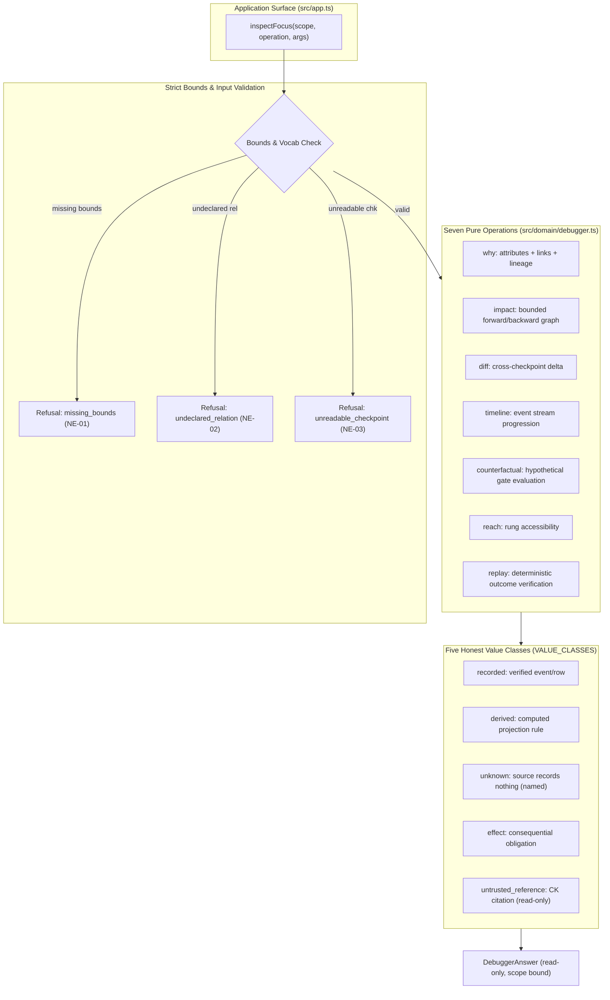

# Subsystem: world debugger

The seven read-only operations that answer "what happened and why" over the operational
projection.

## Purpose

Let an observer interrogate state — focus it, compare it across checkpoints, bound its
downstream impact — with every answer value carrying an honest label: what is recorded,
what is derived, what is unknown, and what is merely a citation.

## Responsibilities

`runDebugger` (`src/domain/debugger.ts:698`) dispatches seven operations:

| Operation | Question | Notes |
| --- | --- | --- |
| `why` | why does the focus look like this? | rows capped (`MAX_WHY_ROWS`) |
| `impact` | what does the focus affect? | bounded traversal; caller-supplied depth/width; undeclared relations refused by name |
| `diff` | what changed between checkpoints? | names the comparison checkpoint in `scope.comparison`; never rewrites the frame's own `checkpoint_ref` |
| `timeline` | when did things change? | rows capped, sorted by time |
| `counterfactual` | what if X were true? | refuses invalid proposals; never executes |
| `reach` | can the observer get from A to B? | rungs model (`REACH_RUNGS`) |
| `replay` | re-derive a past outcome | selects expected outcomes; failing rows reported, never rewritten |

Every answer is a `DebuggerAnswer` whose values are classed into one of five honest
labels: `recorded`, `derived`, `unknown` (naming the source that records nothing), `effect`,
or `untrusted_reference`.

Interactive model: explore all seven operations, bounds checking, and honest value labeling live in
the **[World Debugger Workbench & Epistemic Truth Explorer](../explainers/world-debugger-workbench.html)**.

## Non-responsibilities

- No writes, ever — the debugger is read-only over the projection.
- No authority decisions — it reports; navigation gates decide.
- No trust in retrieval — citations stay `untrusted_reference`
  (see [context kernel](context-kernel-retrieval.md)).

## Position in the system

- Invoked from `src/app.ts` `inspectFocus` (GUI inspection, CLI paths) and directly by
  tests.
- Reads through `src/adapters/operational-objects.ts` behind the same T07 frame the
  renderers use.
- Rendered in the workspace debugger region (`src/ui/workspace/inspect.ts`,
  `render.tsx`) and serialized for programmatic consumers.

## Core abstractions

| Symbol | Location | Role |
| --- | --- | --- |
| `DEBUGGER_OPERATIONS` | `src/domain/debugger.ts:36` | operation vocabulary |
| `VALUE_CLASSES` | `src/domain/debugger.ts:39` | the five honest labels |
| `DebuggerScope` | `src/domain/debugger.ts:52` | frame, focus, checkpoint, bounds |
| `why` / `impact` / `diff` / `timeline` / `counterfactual` / `reach` / `replay` | `src/domain/debugger.ts` | one function each, pure |
| `debuggerCatalogue` | `src/domain/debugger.ts:718` | machine-readable catalogue |
| `inspect` / `debuggerView` | `src/ui/workspace/inspect.ts` | application-surface adapter + view |

## Internal operation

Each operation: resolve scope → validate arguments (bounds required, undeclared relations
refused) → read the projection at the named checkpoint → classify each value → produce the
labelled answer. Cross-checkpoint operations record which checkpoint they compared. An
`unknown` always names the source that records nothing — silence is reported, never filled
with plausible values.

## State

None of its own. Pure functions over adapter reads.

## Failure modes

| Failure | Symptom |
| --- | --- |
| Missing bounds | typed refusal (no defaults) |
| Undeclared relation requested | refusal naming the relation |
| Unreadable checkpoint | typed refusal, distinct from empty results |
| Denied / unavailable / no-match | three distinct observations |

These are exercised by 11 teeth (`test/retrieval-debugger-teeth.test.ts`: NE-01…NE-10 plus
a PE-14 boundary tooth) and a mutation runner (`scripts/teeth-t10-mutation.ts`, 11/11
caught).

## Extension points

New operations join `DEBUGGER_OPERATIONS`, get a pure function, a catalogue entry, teeth,
and surface-grammar registration (which automatically adds MCP tools). Bounds policy is
per-operation and explicit.

## Source trail

- `src/domain/debugger.ts` — all seven operations and value classes
- `src/ui/workspace/inspect.ts` — application-surface inspection adapter
- `test/retrieval-debugger.test.ts`, `test/retrieval-debugger-teeth.test.ts` — contracts
- `scripts/teeth-t10-mutation.ts` — mutation proof
- `.agents/CURRENT_STATUS.md` — T10 settlement record and known limits
