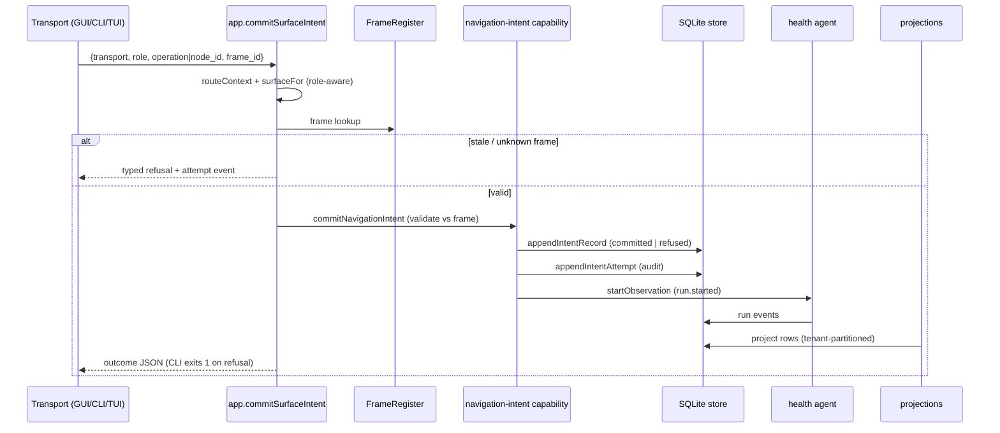

# Workflows and execution traces

What actually happens when you do things in Horizon. Each trace lists the real components
and source symbols involved.

---

## 1. Application startup (server mode)

**Summary.** `bun run src/main.ts` with no subcommand boots the application: config →
semantic world → research probe → runtime → HTTP server.

**Sequence.**

1. `createApplication()` (`src/app.ts:144`) loads `config/horizon.toml` via `loadConfig`
   (`src/config/load.ts`): strict field validation, profile allow-list (`local_operator`),
   loopback bind check, port bounds, per-launch secret written to `.cognate/`
   (`writeLaunchSecret`), principals derived from the OS session (`operatorPrincipal`,
   `agentPrincipal`).
2. The semantic adapter loads the canonical `.sea` world and asserts the pinned
   `world_ref` (`src/adapters/semantic.ts`) — a mismatch throws; startup aborts.
3. The research adapter probes the Python subsystem (`observeResearch`,
   `src/adapters/research.ts`); failure or timeout yields `research_unavailable`
   (degraded, non-fatal).
4. `createHorizonRuntime` (`src/runtime/create.ts`) composes the Cognate runtime over
   `.cognate/app.sqlite`, asserting the store boundary (`assertStoreBoundary` — the store
   path must stay inside the configured store) and registering the read-only capability
   policy plus allowed actions.
5. `startServer()` binds `127.0.0.1:4319` and prints profile, world refs, and semantic
   counts.
6. `SIGINT`/`SIGTERM` → `server.stop()` + `application.close()` (`src/main.ts`).

**State changes.** Launch secret written; runtime store opened; frames register empty.
**Failure branches.** Config error, world mismatch, or store boundary violation → typed
error, non-zero exit. Research failure → degraded start (health endpoint reflects it).

---

## 2. `horizon frame` — issue a frame and (TTY) open a sequential session

**Summary.** The observer's entry point: build the decision snapshot, then render it.

**Sequence.**

1. `application.navigationFrame({focusRef?, caseRef?, purpose?})` → `deriveOperationalNavigation`
   (`src/adapters/navigation.ts`) reads the operational projection at the checkpoint.
2. `buildOperationalFrame` → `buildNavigationFrame` (`src/domain/navigation.ts:575`):
   gate assessment per candidate, Case derivation, view mode, settlement judgment; frame
   deep-frozen, registered, returned.
3. Transport selection (`src/main.ts:61-90`):
   - `--json` → prints `horizon.frame/1` document (frame + prompt + intent schema).
   - `--text` or non-TTY → prints `renderSequentialText(session.prompt)`.
   - TTY → mounts the OpenTUI renderer (`runSequentialTui`) with
     `SequentialTerminal` (`src/ui/sequential/terminal.tsx`).
4. The sequential session asks one question at a time (`openSequential`,
   `promptFor`/`reviewFor`/`notice` in `src/ui/sequential/controller.ts`); selections and
   confirmations produce typed `SequentialIntent`s that are **collected, never executed**
   (the boundary comment in `src/main.ts` is enforced by tests).

**State changes.** A frame is registered (and its issue recorded); the store gains frame
records. **Failure branches.** Unknown focus/case refs → `NavigationError` with typed
reasons; stale sessions are detected (`isStale`) and refreshed rather than silently
acting.

---

## 3. Intent commit — GUI form, CLI `act`, or sequential intent

**Summary.** The only path to recorded action: validate against the issuing frame,
record, observe, project.

**Sequence.**

**Detailed path.** `commitSurfaceIntent` (`src/app.ts:291`) resolves the offered
operation from the role-bound view (`offered`), checks attribution and transport
equivalence, then `commitNavigationIntent` → `navigationIntentComponent`
(`src/capabilities/navigation-intent.ts:230`) validates against the frame register and
appends `INTENT_STREAM` records plus `INTENT_ATTEMPT_STREAM` audit entries (every refusal
is recorded, including spoofed-frame attempts — asserted in `test/app.test.ts`).

**State changes.** Intent event, attempt event, run events, projected rows. **Failure
branches.** Stale frame, unauthorized role, unoffered operation, consequential operation
without authority — all typed refusals with audit.

---

## 4. Inspection — debugger operations and retrieval

**Summary.** Answer "why/impact/diff/timeline/counterfactual/reach/replay" about the
focus, with optional untrusted citations beside the answer.

**Sequence.** `inspectFocus` (`src/app.ts:414`) reads the projection behind the current
frame, builds `DebuggerSources`, calls `runDebugger` (`src/domain/debugger.ts:698`) with
explicit arguments (`argumentsFor` passes caller arguments through — a T10 defect where
they were dropped was fixed), and optionally queries the Context Kernel capability
(`horizon.context.query_reference`). Results render in the workspace debugger region or
serialize as JSON. Retrieval outcomes (`denied`/`unavailable`/`no_match`) and citations
(`untrusted_reference`) are displayed but cannot influence gates.

**Failure branches.** Missing bounds, undeclared relations, unreadable checkpoints →
typed refusals; the 11 T10 teeth assert each refusal *and* that navigation still answers.

---

## 5. Verification gates

**Summary.** Every settlement claim runs through a gate that combines narrow checks,
coverage, adversarial teeth, and the global gate set.

**Sequence.** `just gate-tNN` (T01–T10 implemented; T11–T22 registered but not yet
settled) → narrow check (preregistration shape → coverage → mutation) → global set:
`check boundaries idm-integrity acceptance-claims witness-claims contract-modals test
ledger wayfinder teeth`. `just verify` runs the global set alone. Teeth targets are
deliberately separate from coverage targets so a green consumer path cannot stand in for
an adversarial refusal; mutation runners prove teeth bite by breaking the protected
property and requiring failure.

**Details for each target** live in the [reference](reference.md#just-targets-full-list-justfile); the
frozen-artifact machinery (ledger, wayfinder, preregistration) is explained in
[explanation](explanation.md#frozen-artifacts-and-why-they-exist).

---

## Source trail

- `src/main.ts`, `src/app.ts` — all five traces' entry points
- `src/config/load.ts` — startup validation
- `src/capabilities/navigation-intent.ts` — commit/audit streams
- `src/agents/health.ts` — observation runs
- `src/adapters/research.ts` — degraded-start behavior
- `test/app.test.ts` — end-to-end startup/intent/projection/server contracts
- `test/sequential-cli.test.ts` — real-CLI process tests
- `justfile` — gate composition
